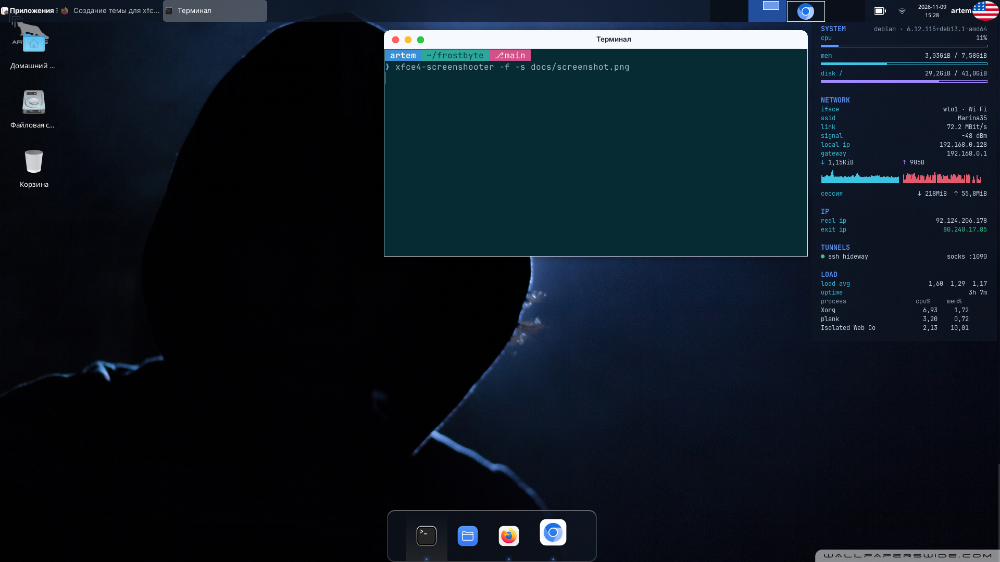

# Frostbyte 1.0 — XFCE

Frosted hacker desktop for XFCE with macOS-style window buttons.
Хакерская «морозная» тема для XFCE с кнопками окон в стиле macOS.



[English](#english) · [Русский](#русский)

---

## English

### What's inside (v1.0)
- **GTK3 theme** on top of WhiteSur Light (blue accent)
- **xfwm4 window frames** with traffic-light buttons on the left
- **Glassy top panel** + side panel, **Plank dock** with Frostbyte theme
- **4 terminal schemes**: Night, Void, Solar, Light
- **Bash prompt** with segments: user · path · git branch · SOCKS tunnel indicator
- **frostfetch** — system info on demand
- **Conky widget**: CPU/RAM/disk, Wi-Fi/Ethernet, local / real / exit IP, SSH & VPN tunnels, network graphs, session traffic, load average, top processes
- **frostbyte-layers** — active window 100 %, inactive windows 85 %
- **Modern CLI**: eza (`ls`, `lt`, `t1`–`t3` trees), bat, fzf (Ctrl+R / Ctrl+T), zoxide (smart `cd`)
- **btop** theme, **Bibata Modern Ice** cursor, frosted **notifications**, round **keyboard flags**
- Wallpaper, Firefox native titlebar buttons

### Install
```bash
git clone https://github.com/canavarro86/ag-frostbyte-xfce.git
cd ag-frostbyte-xfce
./install.sh
```
Terminal scheme (optional): `./install.sh night | void | solar | light`

The installer checks and installs missing packages (asks for sudo), backs up your current
settings to `~/.local/share/frostbyte-backup` and applies the theme to the current user.
Log out and back in after installation.

### Usage
| Command | Action |
|---|---|
| `frostfetch` | system info |
| `~/.local/share/frostbyte/extras/terminal/apply.sh frostbyte-solar` | switch terminal scheme |
| `FB_ACTIVE=100 FB_LAYERS="85" frostbyte-layers` | window opacity levels |
| `lt`, `t1 /usr`, `t2 /var` | directory trees |
| `touch ~/.config/frostbyte/no-tools` | disable CLI tools |

### Uninstall
```bash
~/.local/share/frostbyte/uninstall.sh
```
Restores your previous settings from the backup. Log out and back in.

### Requirements
Debian 12/13 or Ubuntu, XFCE 4.18+, X11 (Wayland is not supported).

---

## Русский

### Что входит (v1.0)
- **Тема GTK3** на базе WhiteSur Light (синий акцент)
- **Рамки окон xfwm4** с кнопками-«светофором» слева
- **Стеклянная верхняя панель** + боковая панель, **док Plank** с темой Frostbyte
- **4 схемы терминала**: Night, Void, Solar, Light
- **Приглашение bash** из сегментов: пользователь · путь · ветка git · индикатор SOCKS-туннеля
- **frostfetch** — сведения о системе по команде
- **Виджет Conky**: CPU/RAM/диск, Wi-Fi/Ethernet, локальный / реальный / выходной IP, SSH- и VPN-туннели, графики сети, трафик за сессию, load average, топ процессов
- **frostbyte-layers** — активное окно 100 %, неактивные 85 %
- **Современные утилиты**: eza (`ls`, `lt`, деревья `t1`–`t3`), bat, fzf (Ctrl+R / Ctrl+T), zoxide (умный `cd`)
- Тема **btop**, курсор **Bibata Modern Ice**, «морозные» **уведомления**, круглые **флаги раскладки**
- Обои, кнопки окна Firefox в стиле темы

### Установка
```bash
git clone https://github.com/canavarro86/ag-frostbyte-xfce.git
cd ag-frostbyte-xfce
./install.sh
```
Схема терминала (необязательно): `./install.sh night | void | solar | light`

Установщик проверит и доставит недостающие пакеты (спросит пароль sudo), сохранит ваши
текущие настройки в `~/.local/share/frostbyte-backup` и применит тему текущему пользователю.
После установки перезайдите в сеанс.

### Использование
| Команда | Действие |
|---|---|
| `frostfetch` | сведения о системе |
| `~/.local/share/frostbyte/extras/terminal/apply.sh frostbyte-solar` | сменить схему терминала |
| `FB_ACTIVE=100 FB_LAYERS="85" frostbyte-layers` | уровни прозрачности окон |
| `lt`, `t1 /usr`, `t2 /var` | дерево папок |
| `touch ~/.config/frostbyte/no-tools` | выключить утилиты терминала |

### Удаление
```bash
~/.local/share/frostbyte/uninstall.sh
```
Вернёт прежние настройки из резервной копии. Перезайдите в сеанс.

### Требования
Debian 12/13 или Ubuntu, XFCE 4.18+, X11 (Wayland не поддерживается).

---

## Software & credits / Софт и авторы
| Component | Author | License |
|---|---|---|
| [WhiteSur GTK & icons](https://github.com/vinceliuice/WhiteSur-gtk-theme) | vinceliuice | GPL-3.0 |
| [Bibata cursor](https://github.com/ful1e5/Bibata_Cursor) | ful1e5 | GPL-3.0 |
| [circle-flags](https://github.com/HatScripts/circle-flags) | HatScripts | MIT |
| JetBrains Mono, Inter | JetBrains, Rasmus Andersson | OFL-1.1 |
| Plank, Conky, btop, eza, bat, fzf, zoxide | their authors | various |

Frostbyte © 2026 canavarro86 — **GPL-3.0**
